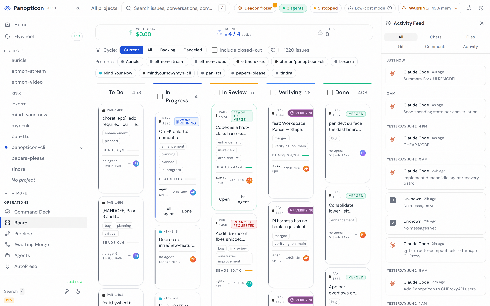
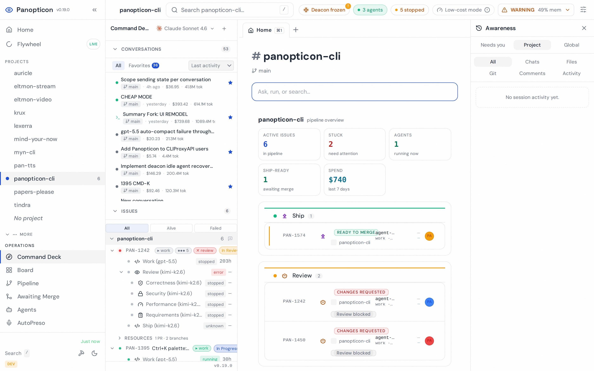
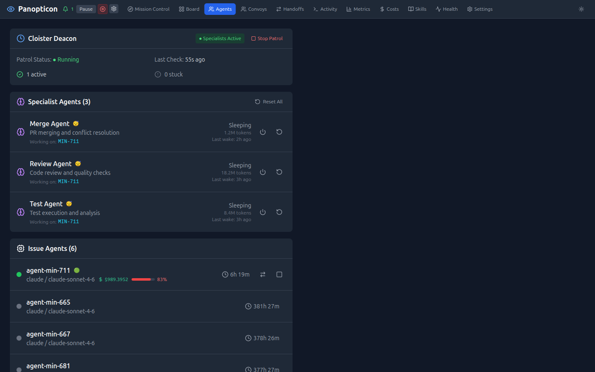
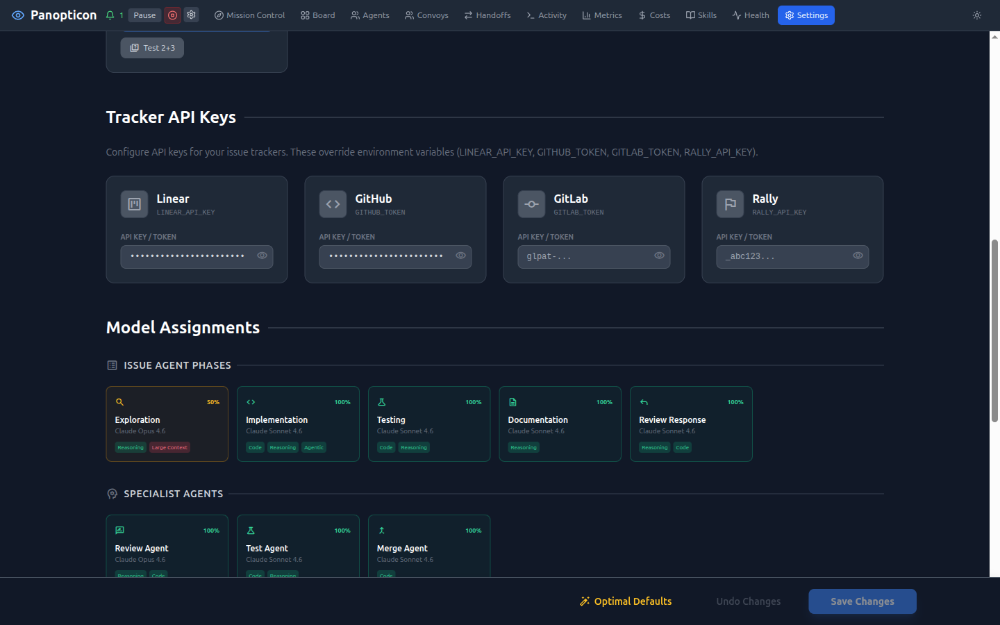

<div align="center">

<picture>
  <source media="(prefers-color-scheme: dark)" srcset="logo/overdeck-dark.svg">
  
</picture>

**The IDE for the agent era**

[](https://www.npmjs.com/package/@overdeck/core)
[](https://opensource.org/licenses/MIT)
[](https://nodejs.org/)
[](https://github.com/eltmon/overdeck/pulls)
[](https://github.com/sponsors/overdeck-ai)

</div>

IDEs were built for humans who type code. Overdeck is built for humans who **direct** it: not with prompts, with **loops**. One agent or twenty, hands-on or hands-off: spawn agents on real issues, watch every diff land live, steer mid-task, and let a built-in specialist pipeline review, test, and merge the work, while you decide exactly how much of the loop runs without you.

<div align="center">

<picture>
  <source media="(prefers-color-scheme: dark)" srcset="docs/screenshot-board-dark.png">
  
</picture>

</div>

## Quick Start

```bash
npx @overdeck/core
```

No install step required. `npx @overdeck/core` starts Command Deck and opens the dashboard in your browser. Use `overdeck` or `pan` after `npm install -g @overdeck/core`. The packaged desktop app is published separately as `@overdeck/desktop`.

**Requires Node.js 22.16+** (or 24+): the floor for the bundled `node:sqlite` driver. If your shell's default Node is older, Overdeck automatically relaunches under an installed compatible Node (Homebrew `node@22`, nvm, fnm, volta, or asdf), no manual switching needed. If none is found, it prints the exact install command for your setup.

Dashboard runs at https://overdeck.localhost (or http://localhost:3011 if you skip HTTPS setup).

See the [full documentation](https://docs.overdeck.ai) for detailed setup, configuration, and usage guides.

---

## Loops, Not Prompts

The industry has caught on to what agent-native developers already knew: the unit of AI-assisted work isn't the prompt, it's the **loop**: act, verify, correct, go again. Models write better prompts than we do now; the scarce skill is designing the loop that keeps agents pointed at the goal, and the verifier that decides whether the work is actually done.

Overdeck is loop machinery, three loops deep:

| Loop | Timescale | What runs |
|:-----|:----------|:----------|
| **Inner, the agent** | seconds to minutes | The harness loop: write code, run it, read the result, try again |
| **Middle, the pipeline** | minutes to hours | The verifier wrapped around every agent: quality gates, review (one reviewer, or a four-lens convoy), tests, browser UAT, and merge batches that keep main green |
| **Outer, the Flywheel** | continuous | The loop that prompts the loops: pulls the next issue from the backlog, drives it end-to-end, files what it finds along the way, and goes again |

The Flywheel is the part most tools don't have. It doesn't run tasks, it runs **revolutions**: every pass around the loop either ships the work or surfaces a defect that gets filed and fixed. It's the loop that improves the loop, and it's how most of Overdeck itself gets built.

### The Autonomy Dial

How much of the loop runs without you is **your choice, per issue, per day**, not a property of the tool:

| Mode | You do | Overdeck does |
|:-----|:-------|:--------------|
| **Pair** | Watch diffs land live, steer the agent in the composer, hand off to another model | Runs the inner loop with per-turn diffs and live cost tracking |
| **Pipeline** | Write the issue, click Merge at the end | Runs the inner and middle loops: plan, implement, review, tests, UAT, merge |
| **Flywheel** | Review the morning recap | Runs all three loops across the backlog, in parallel |

Most sessions live somewhere between: you pair on the gnarly issue while the pipeline ships three routine ones behind you.

---

## Command Deck

Command Deck is the live development surface where you and your agents work together. It's built around three zones that update in real time: no refresh buttons, no polling. Every event animates in as it happens.

| Zone | What You See |
|:-----|:-------------|
| **Issue Header** | Issue identity, pipeline stage, live cost tracking, activity sparkline, quality gate rollup |
| **Agent Context** | Selected agent's role, status, current tool, thinking/waiting state, round history, per-session costs |
| **Conversation + Composer** | Full conversation timeline with composer, or a tabbed dashboard when viewing the issue itself |

### What You Can Do

- **Live diffs as agents code**: every file change appears inline as the agent works. Open the diff panel to review changes turn by turn, or hit "vs main" to see the full picture without waiting for a PR.
- **Talk to your agents**: type in the composer to steer an agent mid-task. Correct its approach, point it at the right file, tell it to rethink: pair-programming, not babysitting.
- **Fork or hand off**: start a new conversation from a summary of this one, or hand off to a different model. A conversation's model is fixed once it starts.
- **Ship without switching tabs**: when the code looks right, review and test agents check it on the pull request, and you click Merge. No CI dashboard to babysit.

### Dashboard views

The sidebar has Project home, Flywheel, Order books and More. More holds Backlog, Board, Pipeline, Awaiting Merge, Activity, Deacon, Knowledge, Skills, Context and Settings. Agents, AutoPreso, Resources, Sessions, Metrics, Costs, Health and God View are experimental: turn on Settings → Experimental → **Experimental features** to see them.

---

## Why Overdeck?

- **You stay in the loop without being in the way.** Watch agents code, review their diffs live, send a message when they drift. You're pair-programming, not babysitting a terminal.
- **The right model for every phase.** A frontier model plans the architecture, faster models write the code and handle mechanical steps. You set the model for each role, and Overdeck uses it every time.
- **Context that outlasts the conversation.** PRDs, xBRIEF plans, project memory and skills carry forward across sessions. Agents pick up where the last one left off, not from a blank slate.
- **One skill format, many harnesses.** Write a SKILL.md once and `pan sync` installs it for Claude Code, Codex and Pi. More than 120 ship out of the box.
- **A pipeline that ships while you move on.** When the implementation looks right, review and test agents check it, with browser UAT where the change has a UI, and merge batches keep main green. You click Merge when you're satisfied, or keep working on the next issue.
- **Built by itself.** Overdeck is developed with Overdeck: its own agents plan, implement, review, test, and merge most of its changes. Every rough edge in the pipeline gets hit by us before it gets hit by you.

---

## How It Works

```
 Issue         PRD           Agent         Review        Test          Merge
┌──────┐    ┌──────┐    ┌──────────┐    ┌──────┐    ┌──────┐    ┌──────────┐
│ Task │ ─► │ Plan │ ─► │ Write    │ ─► │ Code │ ─► │ Run  │ ─► │ Merge    │
│ from │    │ with │    │ code in  │    │ rev- │    │ test │    │ when     │
│ any  │    │xBRIEF│    │ isolated │    │ iew  │    │ +    │    │ green    │
│track-│    │      │    │ worktree │    │      │    │ UAT  │    │          │
│ er   │    │      │    │          │    │      │    │      │    │          │
└──────┘    └──────┘    └──────────┘    └──────┘    └──────┘    └──────────┘
 GitHub
 Linear      Every role runs on the model you choose, and you can
 GitLab      override it per agent.
 Rally
 Jira
```

You can drive any stage from the dashboard, the CLI, or a webhook. Engage as much or as little as you want: from hands-on pair programming with a single agent to launching a fully autonomous pipeline across dozens of issues.

---

## Key Features

| Feature | Description |
|:--------|:------------|
| **Command Deck** | A live workspace where you watch agents code, review diffs inline, send messages, and manage everything from one surface |
| **Fix-All Flywheel** | The outermost loop: an autonomous orchestrator that runs revolutions across the backlog: plan, implement, verify, merge, file what it finds, go again |
| **Inline Diff Review** | See what changed file-by-file as the agent works, compare any turn against main: no waiting for a PR to review code |
| **Multi-Harness** | Agents run on Claude Code, Codex, Pi, OpenCode, Kimi Code, Grok Build and other harnesses. Pick one per role or per spawn |
| **Conversation Forking** | Fork a conversation into a new one from a summary of the work, or hand off to another model |
| **Visual Plans** | Work plans render as interactive DAGs so you can see dependencies, track acceptance criteria, and know what's done |
| **Specialist Pipeline** | Quality gates, review (one reviewer or a four-lens convoy), tests and browser UAT on the pull request. You click Merge, or turn on auto-merge |
| **Merge Trains** | Approved work queues onto main in order, each rebase re-verified, so a busy day of merges never breaks the build |
| **Failsafe Controls** | Pause gates, troubled-agent backoff, boot-scoped no-resume, and a global freeze: autonomy you can always stop |
| **Cloister** | The agent watchdog: checks agent health, nudges stuck agents, restarts crashed ones and recovers stalled reviews |
| **PRD-Driven Workflow** | `pan start` plans each issue before work starts: a PRD and an xBRIEF plan committed to your repo. Skip planning with `--plan skip` |
| **Skills** | More than 120 skills in the SKILL.md format, installed by `pan sync` for Claude Code, Codex and Pi |
| **Context Layers** | One set of rules rendered for every harness: universal, per-project, and per-machine context that agents actually receive |
| **Multi-Tracker Support** | GitHub Issues, Linear, GitLab, Rally and Jira, in one board |
| **Workspaces** | Isolated git worktrees per issue with optional Docker environments, local or remote via Fly.io |
| **Convoys** | Full review mode: four reviewers check one pull request in parallel and a review parent writes the verdict |
| **Cost Tracking** | Per-issue, per-stage token costs with model attribution and daily rollups |

---

## Architecture at a Glance

Overdeck started as a CLI and grew into **Command Deck**, a desktop-class development environment. The CLI, the GUI, and any script that can make an HTTP request all drive the same REST surface: spawn an agent from a kanban card, a terminal, or a webhook without switching tools. Under the hood: an Effect.js + TypeScript server, a React frontend over typed WebSocket RPC, SQLite for state, and Electron as the shell. Launch with `npx @overdeck/core`; keep `pan` for headless and CI, or use `@overdeck/desktop` for the packaged desktop app.

---

## Screenshots

<div align="center">
<table>
<tr>
<td>
<picture>
  <source media="(prefers-color-scheme: dark)" srcset="docs/dashboard-overview-dark.png">
  
</picture>
</td>
<td></td>
</tr>
<tr>
<td align="center"><em>Command Deck: project tree, activity timeline, specialist pipeline</em></td>
<td align="center"><em>Cloister Deacon, specialist agents, and issue agent management</em></td>
</tr>
<tr>
<td colspan="2"></td>
</tr>
<tr>
<td colspan="2" align="center"><em>Tracker integration and capability-based model routing</em></td>
</tr>
</table>
</div>

---

## Supported harnesses

| Harness | Support |
|:-----|:--------|
| **Claude Code** | Full support: agent runtime, hooks, skills |
| **Codex** | Agent runtime and skills |
| **Pi** | Agent runtime and skills |
| **OpenCode** | Agent runtime |
| **Kimi Code** | Agent runtime |
| **Grok Build** | Agent runtime |

See [Harnesses](https://docs.overdeck.ai/configuration/harnesses) for the full list.

---

## Requirements

### Required
- Node.js 22.16+ (or 24+)
- Git
- GitHub CLI (`gh`) or GitLab CLI (`glab`)

### Installed by `pan install`
- Herdr (the default terminal backend), ttyd, jq

### Optional
- Docker (workspace containers and Traefik)
- mkcert (HTTPS certificates)
- tmux (only with `terminal.backend: tmux`)
- A Linear, Jira or Rally API key for those trackers

---

## Maturity

Overdeck is actively used in production to develop itself and multiple other projects. Most of the code in this repository was planned, written, reviewed, tested, and merged by Overdeck's own pipeline.

- **2,200+ issues** filed against this repo; hundreds shipped end-to-end through the pipeline
- **More than 120 skills** shipped and synced
- **5 tracker integrations** (GitHub, Linear, GitLab, Rally, Jira)
- **Many agent harnesses** (Claude Code, Codex, Pi, OpenCode, Kimi Code, Grok Build and others) and models from many providers, chosen per role
- **Review and test agents** that check every pull request

---

## Documentation

Full documentation at **[docs.overdeck.ai](https://docs.overdeck.ai)**

| Document | Description |
|----------|-------------|
| [Quick Start](https://docs.overdeck.ai/quickstart) | Installation and setup |
| [Core Concepts](https://docs.overdeck.ai/concepts) | Architecture and key concepts |
| [CLI Reference](https://docs.overdeck.ai/cli/overview) | All available commands |
| [Features](https://docs.overdeck.ai/features/mission-control) | Command Deck and other features |
| [Guides](https://docs.overdeck.ai/guides/legacy-codebases) | Step-by-step guides |

---

## Support Overdeck

Overdeck is free, MIT-licensed, and built by one developer directing a fleet of agents. The fleet isn't free: the model bills behind Overdeck's own development run about **$1,000/month**, all self-funded.

If Overdeck saves you time, [**sponsoring on GitHub**](https://github.com/sponsors/overdeck-ai) directly keeps the agents running. Even $5/month genuinely helps.

---

## Contributing

Contributions welcome! See [CONTRIBUTING.md](CONTRIBUTING.md) for guidelines.

---

## License

MIT License - see [LICENSE](LICENSE) for details.

The hosted-service code in [`services/`](services/) (the overdeck.ai account service, the Shared Sessions share service and the Anywhere connect service) is licensed separately under the [Functional Source License, Version 1.1, MIT Future License](services/LICENSE.md) (FSL-1.1-MIT). You can read, run, modify and self-host it, including inside your company; you cannot offer it as a competing commercial service. Each release becomes MIT two years after it is made available.

---

<div align="center">
<p><a href="https://github.com/eltmon/overdeck">GitHub</a> · <a href="https://www.npmjs.com/package/@overdeck/core">npm</a> · <a href="https://docs.overdeck.ai">Documentation</a> · <a href="https://github.com/sponsors/overdeck-ai">Sponsor</a></p>
</div>
