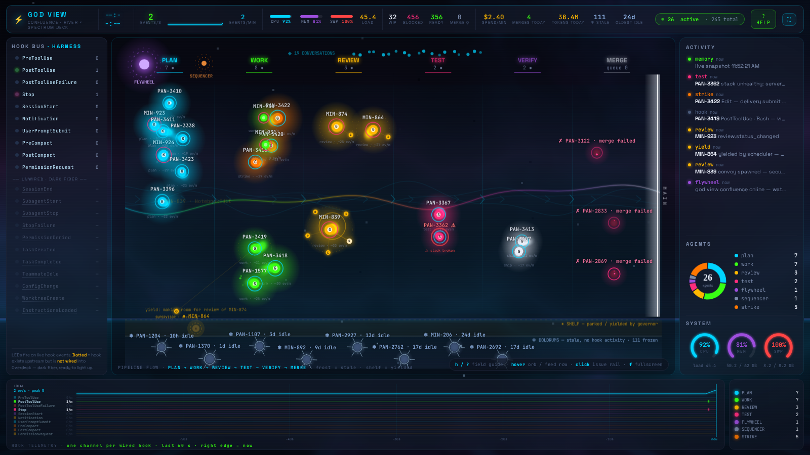

# God View: Confluence

Confluence is the production center canvas at `/god-view`. It combines the
pipeline geography from the River mockup with the live telemetry language from
Spectrum Deck, while keeping every displayed issue, agent, hook event, cost,
and status grounded in dashboard state.

## What Confluence shows

- **The river engine** places issue orbs in the `PLAN → WORK → REVIEW → TEST →
  MERGE` flow. Each orb has its own vertical slot in its stage column, so
  labels do not print over each other. The WebGL aurora reacts to live hook
  energy, with a canvas-only background when WebGL is unavailable. The PLAN,
  REVIEW, and TEST column counts include only issues with a live (running or
  starting) agent of that role — a stopped plan, review, or test agent cannot
  pin an issue's displayed stage after a live work agent has already moved it
  on.
- **Issue orbs** encode project, role, model glyph, stage, heat, and operational
  state. Heat (size, glow and orbit speed) is the issue's real hook-event rate
  over the last 60 seconds. The tag under the id is `<role> · <n> ev/m`, or
  `<role> · quiet` when there were none. The ring color follows the issue
  prefix: PAN cyan, MIN magenta, and one fixed palette color for each other
  prefix. The hook stream keeps at most 500 entries, so above 500 events per
  minute a per-issue count can read low; the top-bar EV/M has the same limit.
  Review convoys orbit one issue orb so parallel reviewers remain one
  pipeline unit rather than appearing as unrelated work.
- **Agent micro-states** show waiting, thinking, compaction, cost pulses, stack
  warnings, and merge activity on the orb that owns the work.
- **The shelf and Doldrums** are two disjoint bands that never overlap, each
  with its own header row so labels and reasons stay inside their band. The
  shelf (upper band, header `⏸ SHELF — paused / parked / yielded`) holds orbs
  whose agents are paused by an operator or the pipeline, or yielded by the
  scheduler/governor — at most 8, longest-idle first, each with its reason
  truncated to fit the slot (the full reason is in the hover card). The
  Doldrums (lower band, below the shelf with a gap) holds stale orbs (no
  events for 30 min) and parked issues, arranged in two rows — at most 14.
  A merged issue whose agents carry only the close-out pause
  (`awaiting close-out (verify on main)`) is not shelved: it stays `active` in
  MERGE and exits through the portal; any other pause on a merged issue still
  shelves it. Frost on an active orb is computed from real idle minutes: it
  starts at 8 and is full at 34. The data, not the canvas, moves an orb to the
  Doldrums at 30 idle minutes. A governor tide marks a scheduler yield the
  data already made: it rings the yielded orb and names no beneficiary.
  The Doldrums is also the parked population's home (see "The Stall Sweeper"
  below).
- **The merge portal and red rings** show the path into `main` and the queued
  merge depth. The portal comet plays only for an issue whose derived state is
  `merged`; any other orb that leaves MERGE fades. A red blinking ring in a
  stage column marks an issue whose attention is `stuck`
  (label `stuck, unpushed work`) or `api-error` (label `API error`).
- **The Stall Sweeper** (PAN-3490) renders the parked population and the
  sweeper's work: parked orbs settle in the Doldrums with orbit-tinted frost
  and an orbit tag with the park age; an ice-blue lantern beam sweeps the band
  on every real population change, glinting each frozen orb it passes; an orb
  plays the thaw effect when its refreshed state is active again; an
  operator-only release fires a slow-rising signal flare. The 🧹 PARKED top-bar stat is the true census, and VEL/h shows real
  stage-transition rate. An `idle-running` orb's parked row may carry a Jev
  turn-end reading — `details.turnEnd` and a "last message reads as: …"
  clause — when `jevTurnEndAssessment` is on (PAN-4371) — advisory only, it never selects or
  triggers a sweeper action. `runStallSweeperPatrol` currently has no
  scheduler caller (PAN-3917 W4), so this sweeper sentence only appears when
  the sweeper is run by hand.
- **The Flywheel sun and sequencer** are lit and animated only while the
  Flywheel run or the sequencer agent is live; otherwise they are drawn dim
  and still. The conversation constellation above the river shows the live
  conversation count.
- **The hook bus** renders the 21-entry contracts inventory in canonical order.
  Wired hooks receive event-driven LEDs and counters; unwired hooks remain dim
  dark fiber with an em dash rather than invented activity.
- **The bottom telemetry strip** draws one 60-second channel per wired hook,
  real event ticks, burst intensity, aggregate events per second, and the live
  role-count box. No decorative event bands are generated.
- **The activity feed and orbs are linked.** Hovering an issue-linked feed row
  opens its full provenance tooltip and flashes the matching orb; clicking the
  row or orb opens the in-canvas issue rail, and the rail's button opens
  `/issues/<id>`.
- **The enriched top bar** shows the clock, event rate and ECG, CPU, memory,
  memory pressure (PSI), load, merge queue, cost rate, merges, tokens, stale
  count, oldest idle age, active count, help, and fullscreen. Missing sources render `—` instead of a fabricated zero.
- **Memory pressure is PSI, not swap fill.** The PSI meter (top bar and
  sidebar gauge) reads `/proc/pressure/memory` `some` avg10. It turns amber at
  `some` ≥ 5% and red at `full` ≥ 1%. Swap in/out adds amber at ≥ 64 MiB/min and
  red at ≥ 256 MiB/min only while admission is `soft` or `blocked` (memory
  below reserve). These are the bands and the gate the host evaluator uses.
  Swap occupancy appears only in the hover detail: a full swap of cold pages is
  not pressure and can never color the meter.

## Glyph language

| Glyph | Meaning |
| --- | --- |
| Orb | One issue and its current primary agent role |
| Orbiting satellites | Review convoy members attached to the same issue |
| Shelf | Paused, parked, or scheduler-yielded work that still belongs to the pipeline (operator holds included; close-out pauses on merged issues excluded) |
| Frost / Doldrums | Increasing idle age and work that crossed the stale threshold |
| Orbit-tinted frost | A parked issue — the frost color names its orbit (slate `operator-gate`, ash `zombie-session`, ice `idle-running`) |
| Sweeper beam | A real parked-population scan (sweep.scan) crossing the Doldrums |
| Thaw | A stale orb whose refreshed state is active again; the effect decorates the orb and does not move it |
| Signal flare | A parked orb only a human can release (sweep.escalated) |
| Flare ring on the shelf | An issue whose agent asked the operator a decision with `pan ask` (needs you) |
| Portal | Merge path into `main`; the comet plays only for a merged issue |
| Red blinking ring | An issue that is stuck with unpushed work, or hit an API error |
| Flywheel sun / sequencer | The Flywheel run and the sequencer agent; lit and animated only while live |
| Hook bus LED | A real event from a wired harness hook |
| Telemetry trace | Real wired-hook events over the latest 60 seconds |

Model glyphs are compact labels inside active orbs. Their surrounding color
still comes from the issue's role and project, so the glyph supplements the
orb language rather than replacing it. The letters are S sonnet, O opus,
H haiku, F fable, G gpt, E gemini, X grok, Z glm, Q qwen, L quantum-llama,
M muse, N minimax or mimo, I mistral and K kimi; any other model shows the
first letter of its name.

## Interactions

- Hover an orb for its issue, stage, role, project, state, model, harness, hook
  rate, frost, event count, stale age, yield reason, warning, and convoy data.
- Click an orb or an issue-linked activity row to open the in-canvas issue
  rail. The rail's button opens `/issues/<id>`.
- Hover an issue-linked activity row to show the source, full message, and
  timestamp while flashing the matching orb.
- Press `h` or `?` to toggle the field guide, `Escape` to close it, and `f` to
  toggle fullscreen. Shortcuts do nothing while a text field or another modal
  owns focus.

## Data flow and honesty contract

The river cast comes from the shared dashboard snapshot and Zustand read model.
`EventRouter` receives the snapshot and subsequent domain events over `/ws/rpc`;
`useConfluenceData()` derives orbs, hook energy, micro-states, and metadata from
that same state. The parked cast comes from `GET /api/parked` fetched once and
invalidated only by a real `sweep.scan` domain event when the parked population
changes — no polling loop and no synthesized motion. Velocity
(`GET /api/velocity`) refreshes on the inherited 30-second cadence shared with
the host-health and cost queries. Harness heartbeats become domain events
before they enter the hook stream, so Confluence adds no polling loop for river
or hook animation.
The inherited host-health query and activity-feed REST fallback keep their
existing polling cadence, but they do not synthesize visual events.

Agent liveness comes from the terminal backend, not from agent rows. A row's
stored status (`running`, `starting`, `warning`, …) counts only when the
backend inventory (`backendPanesById`, the pane list the liveness oracle
`src/lib/agents/liveness.ts` judges) holds a non-exited pane for that agent.
A row that claims `running` with no pane is treated as stopped: it puts no orb
on the river and is left out of the active count, the role-count box, and the
AGENTS donut. An operator-paused issue still sits on the shelf, and an issue
with an open PR still shows in the merge lane, as they do for any stopped agent.

The contract is **cast real, motion real**:

- **Cast real:** every issue, agent, conversation, hook, role count, queue depth,
  and health value comes from a real source. An unavailable source displays
  `—`, dark fiber, or an empty state.
- **Motion real:** animation visualizes a real transition or current state.
  Hook sparks require hook events, frost requires idle time, governor tides
  require yielding, merge motion requires merge state, and trace marks require
  events in the visible window.
- **Nothing simulated:** the canvas never writes an orb's state or stage, and
  no displayed age or rate is stored. Ages are computed from `lastActivity` or
  `parkedAt` when read. Per-issue rates are counted from the trailing 60
  seconds of hook events. A 30-second local clock tick, which fetches nothing,
  re-evaluates the 30-minute stale threshold on a quiet system.

The center canvas is intentionally exempt from the normal dashboard style guide
so the dense ambient visualization can preserve the approved Confluence visual
language. Dashboard controls and data-door rules still apply.

## Implementation map

- Page composition: `src/dashboard/frontend/src/components/GodView/index.tsx`
- Shared live data: `src/dashboard/frontend/src/components/GodView/confluence/useConfluenceData.ts`
- River and effects engine: `src/dashboard/frontend/src/components/GodView/confluence/RiverCanvas.tsx`
- Pure derivations (ages, rates, layout, glyphs): `src/dashboard/frontend/src/components/GodView/confluence/model.ts`
- Local clock tick: `src/dashboard/frontend/src/components/GodView/confluence/useNowTick.ts`
- Hook rail: `src/dashboard/frontend/src/components/GodView/confluence/HookBus.tsx`
- Telemetry strip: `src/dashboard/frontend/src/components/GodView/confluence/BottomStrip.tsx`
- Field guide: `src/dashboard/frontend/src/components/GodView/confluence/ConfluenceHelp.tsx`
- Approved mockup: `design/style-guide/mockups/god-view-confluence.html`
